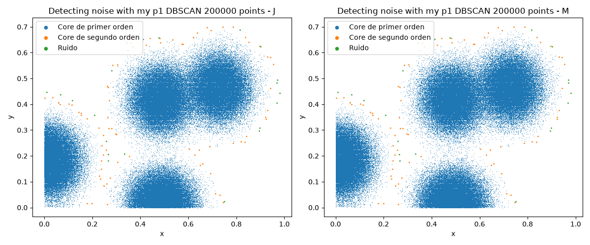
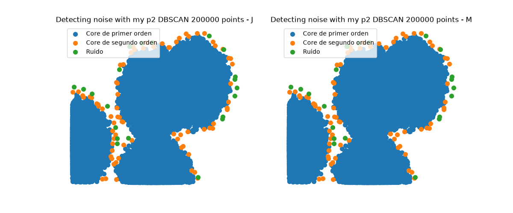
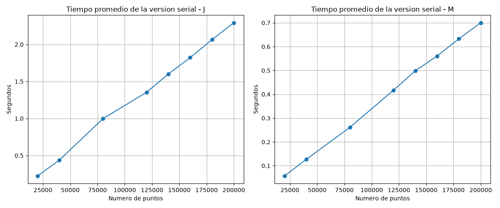
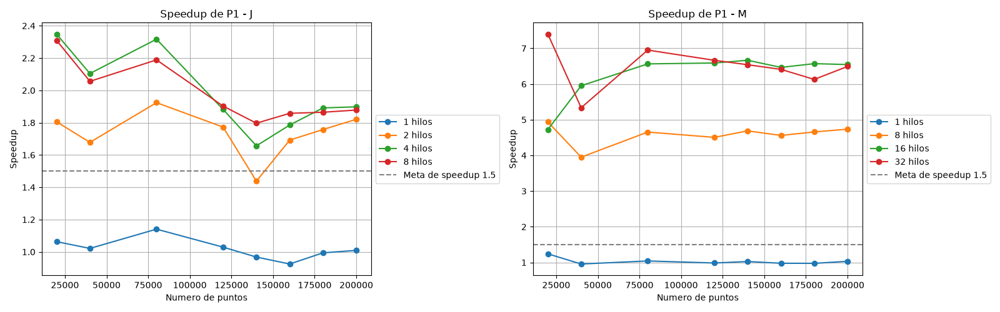
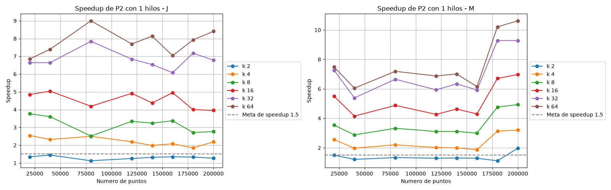
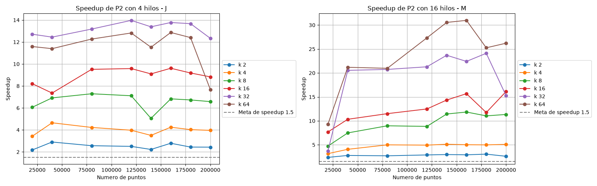

# DBSCAN
## Integrantes
* Jose Luis Santiago Heredia - 208322
* Miguel Ángel Herrera - 206111

## Objetivo
Tenemos puntos en 2D y queremos saber cuáles son ruido, es decir, son aislados, y cuáles están en una zona densa.
Para esto usamos dos cosas: un epsilon, que es la distancia máxima para considerar que dos puntos están cerca (menor o igual a 0.03), y un min_samples, que es el mínimo de puntos cerca para que se considere zona densa (10, contando el propio punto).

## Programa
### Puntos
Cada punto puede terminar con tres etiquetas:
* Core de primer orden: Tiene al menos min_samples puntos, en este caso 10, a distancia menor o igual a epsilon, contándose a sí mismo
* Core de segundo orden: No es core de primer orden, pero está a una distancia menor o igual a epsilon de algún core de primer orden
* Ruido: Ninguna de las dos

### Algoritmo
1. Cada punto cuenta cuántos puntos están a una distancia menor o igual a epsilon (contándose a sí mismo). Si llega a min_samples, se pone como core de primer orden, y si no, es ruido provisional.
2. Para los ruidos provisionales, revisa si hay algún core de primer orden a una distancia menor o igual a epsilon. Si sí hay, pasa a core de segundo orden, y si no, se queda como ruido.

El paso 2 necesita que el paso 1 ya haya terminado para todos los puntos, porque tiene que saber quiénes son core.

Este algoritmo puede tomar mucho tiempo, porque cada punto se compara contra los n puntos, entonces el costo es O(n^2) en el peor caso. Por eso, aquí veremos cómo paralelizarlo.

## Códigos
### Serial
El serial es la base contra la que se comparan las dos versiones paralelas, así que tiene que ser correcto y estar bien medido. Está en `dbscanSerial.cpp` y está dividido en funciones pequeñas:
* `contarPuntos` abre el csv y cuenta cuántos renglones tiene, para saber de qué tamaño pedir los arreglos.
* `leerPuntos` guarda la coordenada x de cada punto en un arreglo y la coordenada y en otro.
* `sonVecinos` calcula la distancia euclidiana, y regresa verdadero si es menor o igual a epsilon. 
* `dbscanSerial` tiene los dos pasos del algoritmo.
* `escribirResultados` escribe un csv con x, y y la etiqueta de cada punto (0 ruido, 1 core de primer orden, 2 core de segundo orden), que es el formato que lee la libreta para dibujar la clasificación.

En el paso 1, cada punto recorre los demás y cuenta sus vecinos, pero deja de contar en cuanto llega a min_samples, porque ya se sabe que es core y seguir contando no cambia el resultado. En el paso 2, cada ruido busca un core de primer orden cercano y deja de buscar en cuanto encuentra uno. Solo se compara contra cores de primer orden, nunca contra los de segundo orden. Así el resultado no depende del orden en que se recorren los puntos, y eso es lo que permite después paralelizar sin que cambien las etiquetas.

El main hace el experimento. Recorre los 8 tamaños, y para cada uno lee los puntos, hace una corrida de calentamiento que no se mide, porque la primera corrida siempre tardaba más, y luego corre el algoritmo 10 veces y guarda el promedio en `datos/tiempos_serial_J.csv` o `_M`, según la letra que se le pase, lo cual es un parámetro que utilizamos para distinguir la computadora donde se corrió el experimento. El tiempo se mide con clock() justo antes y justo después de llamar a `dbscanSerial`, así que la lectura y escritura de archivos no cuentan, porque eso no se paraleliza. Como el serial corre en un solo hilo, clock() equivale al tiempo real.

Para comprobar que el serial es correcto se comparó contra el DBSCAN de sklearn con los mismos parámetros. La comparación está en la tercera celda de `DBSCAN_noise_proyecto.ipynb` y el resultado está en la sección de Resultados.

Para compilar y correr los tres programas, desde la carpeta del proyecto, después de generar los puntos con la primera celda de `DBSCAN_noise_proyecto.ipynb`:
```
g++ dbscanSerial.cpp -o dbscanSerial
g++ dbscanP1.cpp -o dbscanP1 -fopenmp
g++ dbscanP2.cpp -o dbscanP2 -fopenmp
.\dbscanSerial.exe J
.\dbscanP1.exe J
.\dbscanP2.exe J
```

### P1: Paralelo sobre toda la matriz
En P1 se le agrega el paralelismo al serial. Usamos OpenMP para repartir el trabajo entre varios hilos. Se pone el #pragma omp parallel for para repartir las vueltas del ciclo entre los hilos, y esto solo funciona si las vueltas son independientes. Al terminar el parallel for, el programa espera a que todos los hilos acaben antes de seguir.

Este programa es muy similar al serial, solo que le añadimos el paralelismo.

En el paso 1, cada hilo toma ciertos puntos y escribe la etiqueta de cada uno. No hay conflicto porque cada posición de la etiqueta la escribe un solo hilo.

Para el paso 2, el resultado del paso 1 se guarda en un arreglo aparte que ya no cambia, y las etiquetas finales se escriben en otro arreglo llamado etiqueta. Esto es para evitar una condición de carrera. Con esto, el paso 2 solo lee de un arreglo que no cambia y escribe en otro, así nadie lee lo que otro escribe.

Finalmente, se hace la prueba con distintas cantidades de hilos, y se comparan las etiquetas con las del serial. 

Los tiempos de P1 y P2 se miden con omp_get_wtime(), que mide tiempo de reloj de pared. No se usa clock() en las versiones paralelas porque suma el tiempo de CPU de todos los hilos, así que el tiempo paralelo saldría inflado y el speedup subestimado. El serial sí usa clock(), pero como ejecuta un solo hilo, su valor equivale al tiempo real y la comparación es válida. Con los tiempos se calcula el speedup (T_serial / T_paralelo).

### P2: Paralelo dividido en particiones
La idea de P2 es que en esta ocasión el plano se divide en k pedazos (particiones), y cada punto se compara contra los puntos de su propia partición y contra los de las particiones vecinas que estén cerca, en lugar de compararse contra todos. Sigue siendo el mismo algoritmo, solo cambia dónde busca y cómo se reparte el trabajo, y las etiquetas tienen que salir igual que en el serial.

Para hacer esto, primero se calcula la cuadrícula: se convierte k en columnas x filas (2 es 2x1, 4 es 2x2, 8 es 4x2 y así hasta 64, que es 8x8), y se buscan los valores mínimos y máximos de x y de y para calcular qué tan ancha y qué tan alta es cada celda. Después a cada punto se le calcula su partición, y las particiones quedan numeradas de 0 a k - 1. Con eso, cada partición arma su propia lista de puntos: los que son suyos y también los de las particiones vecinas que caen a una distancia menor o igual a epsilon de su rectángulo, a los que llamamos el borde (en el código se llama halo). Cada lista guarda solo el índice original de cada punto, y las coordenadas se leen de los mismos arreglos x y y que usan el serial y P1.

El borde es necesario porque un punto cerca de la frontera puede tener vecinos en la partición de al lado, y si no los contamos se clasificaría mal. Cualquier vecino de un punto está a distancia epsilon o menos, así que siempre cae dentro del rectángulo de su partición agrandado por epsilon. Por eso la lista de cada partición contiene todos los vecinos posibles de sus puntos, no se pierde ninguno y las etiquetas coinciden con las del serial.

Después P2 tiene dos parallel for sobre las particiones, uno para cada paso. En el paso 1, cada hilo toma una partición, primero arma su lista, y después para cada uno de sus puntos cuenta cuántos vecinos hay en la lista de la partición a una distancia menor o igual a epsilon, y deja de contar al llegar a min_samples, igual que el serial. Si llega es core de primer orden, y si no, es ruido provisional. Cada punto pertenece a una sola partición, y su etiqueta se escribe por su índice original, entonces cada hilo solo escribe los puntos de sus propias particiones y no hay conflicto. Al terminar el parallel for se espera a que todos los hilos acaben el paso 1, porque el paso 2 necesita saber quiénes son core, incluso los que son de otra partición. En el paso 2, para los ruidos provisionales se revisa si en la lista hay algún core de primer orden a una distancia menor o igual a epsilon, y si sí hay, pasa a core de segundo orden. Igual que en P1, al terminar el paso 1 se hace una copia de las etiquetas, y en el paso 2 se lee de la copia, que ya no cambia, y se escribe en las etiquetas finales, para que nadie lea lo que otro escribe.

Es importante mencionar que usamos schedule(dynamic, 1), que es cuando un hilo termina su partición y pide otra, en lugar de tener un reparto fijo. Esto es porque las particiones no tienen la misma cantidad de puntos, entonces con un reparto fijo unos hilos acabarían antes y se quedarían esperando. Con dynamic se reduce esa espera.

Otra cosa importante es que k limita el paralelismo: con k = 2 solo hay dos particiones, entonces aunque haya más hilos no tienen trabajo que tomar.

Por último, P2 puede ser más rápida incluso con un solo hilo. Probablemente porque cada punto se compara contra menos puntos (los de su lista, y no los n) y porque los puntos de una lista están cerca en el plano. Este efecto no se debe al paralelismo, por eso hay que separar el efecto de k del efecto de los hilos.

## Resultados
### Equipos
El experimento se corrió completo en dos computadoras. Para distinguirlas, todos los archivos de `datos` y `graficas` terminan con una letra: J para la computadora de José Luis y M para la de Miguel. Los programas reciben esa letra al ejecutarse, por ejemplo `.\dbscanP1.exe J`. Además, cada gráfica se guarda también con las dos computadoras juntas, y esa termina con U de unión.

* José Luis: Intel Core i3 1115G4, con 2 núcleos físicos y 4 cores virtuales, Windows 10, con g++ 16.1.0 de MSYS2. Los hilos probados fueron 1, 2, 4 y 8.
* Miguel: AMD Ryzen AI 7 350, con 8 núcleos físicos y 16 cores virtuales (2 hilos por núcleo), 8 MB de caché L2 y 16 MB de L3, y 7 GB de RAM. Corre en Ubuntu dentro de WSL2 sobre Windows, con g++ 15.2.0. Los hilos probados fueron 1, 8, 16 y 32.

Los programas se compilaron como en las diapositivas de OpenMP, con `g++ archivo.cpp -o archivo -fopenmp` en P1 y P2, y sin `-fopenmp` en el serial porque no usa OpenMP. No se agregó ninguna opción de optimización, y en las dos computadoras se usaron exactamente los mismos comandos, para que el serial, P1 y P2 se comparen en las mismas condiciones. En la computadora de Miguel los programas se corrieron como `./dbscanSerial M`, `./dbscanP1 M` y `./dbscanP2 M`. Los hilos no están fijos en el código: cada programa mide los cores virtuales con `omp_get_num_threads()` y de ahí saca 1, la mitad, todos y el doble.

### Verificación
Cada configuración compara sus etiquetas contra las del serial y avisa con un mismatch si hay diferencias. En las dos computadoras ninguna configuración avisó mismatch en los 8 tamaños, con todos los valores de k y de hilos. Además, los archivos de resultados son idénticos entre los tres programas y entre las dos computadoras.

Aquí se muestran las gráficas unidas, donde la computadora de José Luis está a la izquierda y la de Miguel a la derecha. Las de cada computadora por separado están en `graficas` con J o M al final.




### Serial
El tiempo crece casi en línea recta con el número de puntos, aunque el algoritmo compara todos contra todos. Esto pasa porque casi todos los puntos son core y dejan de buscar en cuanto encuentran sus 10 vecinos. Solo los pocos puntos de ruido recorren todo el arreglo.

| Puntos | José Luis (s) | Miguel (s) |
|---|---|---|
| 20000 | 0.223 | 0.184 |
| 80000 | 0.997 | 0.714 |
| 120000 | 1.353 | 1.052 |
| 200000 | 2.292 | 1.841 |



Para comprobar que el serial da el resultado correcto, se comparó contra el DBSCAN de sklearn con los mismos parámetros, eps = 0.03 y min_samples = 10, usando los mismos archivos de puntos. sklearn marca el ruido con la etiqueta -1 y nuestro programa con 0, así que se comparó punto por punto si cada uno es ruido o no. Los cores de primer y de segundo orden de nuestro programa corresponden a los puntos que sklearn mete en algún cluster.

| Puntos | Ruido sklearn | Ruido serial | Diferencias |
|---|---|---|---|
| 20000 | 45 | 45 | 0 |
| 40000 | 33 | 33 | 0 |
| 80000 | 34 | 34 | 0 |

No hubo ninguna diferencia. Solo se usaron estos tres tamaños porque sklearn guarda en memoria todos los vecinos de cada punto, y con 200000 puntos eso ocuparía alrededor de 6.6 GB. Como P1 y P2 dan exactamente las mismas etiquetas que el serial, también coinciden con sklearn.

### P1
Speedup de P1 contra el serial con 200000 puntos:

| José Luis | 1 hilo | 2 hilos | 4 hilos | 8 hilos |
|---|---|---|---|---|
| Speedup | 1.01 | 1.82 | 1.90 | 1.88 |

| Miguel | 1 hilo | 8 hilos | 16 hilos | 32 hilos |
|---|---|---|---|---|
| Speedup | 1.03 | 4.74 | 6.55 | 6.49 |

Con 1 hilo P1 tarda prácticamente lo mismo que el serial, lo cual tiene sentido porque es el mismo algoritmo. En la computadora de José Luis, con más hilos mejora hasta que se acaban los núcleos reales, y el tope es de cerca de 2, porque solo tiene 2 núcleos físicos. Los 4 cores virtuales son esos 2 núcleos con dos hilos cada uno, que comparten recursos, por eso de 2 a 4 hilos se gana poco y con 8 ya no se gana nada. Con los tamaños chicos P1 llega a 2.35, y desde 120000 puntos se queda en cerca de 1.9. Los tamaños chicos se miden en los primeros segundos de la corrida, y lo más probable es que después la laptop baje la frecuencia del procesador para no pasarse de su límite de potencia, lo que afecta más cuando trabajan los dos núcleos. En la de Miguel el speedup llega a 4.74 con 8 hilos (un hilo por núcleo físico) y a 6.55 con 16, y con 32 ya no mejora (6.49). Con 32 hilos solo se gana algo con 20000 puntos (7.4). Desde 80000 puntos queda igual que con 16 hilos, cerca de 6.5, y con 1 hilo el speedup es de 1 en todos los tamaños.



### P2
En P2 hay que separar dos efectos, el de k y el de los hilos.

El efecto de k se ve con 1 hilo, donde no hay paralelismo. Aun así P2 es más rápido que el serial, y en general más entre más grande es k. Speedup de P2 con 1 hilo contra el serial con 200000 puntos:

| | k = 2 | k = 4 | k = 8 | k = 16 | k = 32 | k = 64 |
|---|---|---|---|---|---|---|
| José Luis | 1.3 | 2.2 | 2.8 | 4.0 | 6.8 | 8.4 |
| Miguel | 2.0 | 3.2 | 4.9 | 7.0 | 9.3 | 10.6 |

La mejora se debe a que cada punto se compara contra los puntos de la lista de su partición y no contra los n puntos, y esos puntos están cerca en el plano, así que junta sus vecinos más rápido. En la computadora de José Luis el speedup sube con k en todos los tamaños, hasta 8.4 con k = 64. En la de Miguel también sube con k en todos los tamaños. Con k = 64 llega a entre 6 y 7.5 hasta 160000 puntos, y a 10.2 con 180000 y a 10.6 con 200000.

Con varios hilos P2 mejora todavía más, pero los hilos le ayudan menos que a P1. Esto pasa por tres razones:
* Con k particiones solo puede haber k hilos trabajando, así que con k = 2 el máximo es 2.
* Las particiones tienen cantidades de puntos muy distintas, porque los puntos vienen de 4 nubes. Con k = 4 la partición más grande tiene el 39% de los puntos, y con k = 64 tiene el 11% y hay 9 particiones vacías. Los hilos que terminan antes tienen que esperar a la partición más grande.
* Armar las listas también entra en el tiempo medido, y cada partición recorre los n puntos para armar la suya, así que ese trabajo crece con k. Con k = 64 cada partición tiene pocos puntos propios, así que recorrer los n puntos para armar su lista pesa más en proporción.

Esos dos últimos tamaños en la computadora de Miguel salen mejor que los anteriores sin que el algoritmo cambie: con k = 64 y 1 hilo, P2 tarda 0.234 s con 160000 puntos y 0.158 s con 180000, o sea que tarda menos con más puntos. Lo mismo se ve en los speedups con más hilos, por ejemplo con 16 hilos y k = 64 pasa de 28 a 46. Como los tamaños se corren uno tras otro, lo más probable es que el estado de la computadora (frecuencia del procesador o procesos en segundo plano) cambió entre esas corridas, pero no lo comprobamos. Por eso los speedups de 180000 y 200000 puntos de Miguel conviene leerlos con cuidado, y con los tamaños menores P2 con k = 64 y 8 a 32 hilos da entre 17 y 41.

El mejor speedup de P2 contra el serial fue de 16.9 en la computadora de José Luis, con 80000 puntos, k = 64 y 4 hilos, y de 56.0 en la de Miguel, con 200000 puntos, k = 64 y 32 hilos. Con 200000 puntos y k = 64, los speedups en la de José Luis son 11.7 con 2 hilos, 14.7 con 4 y 14.1 con 8, y en la de Miguel son 48.5 con 8 hilos, 54.5 con 16 y 56.0 con 32.

En la computadora de Miguel, pasar de 8 a 16 hilos mejora poco P2 con k = 64, y de 16 a 32 casi nada. Esas corridas duran pocos milisegundos, y con todos los cores virtuales ocupados cualquier otro proceso de la computadora puede retrasar a algún hilo y los demás tienen que esperarlo.




### Comparación entre P1 y P2
Las dos versiones pasan la meta de speedup de 1.5 en las dos computadoras. P2 fue mucho más rápida en tiempo total, pero sobre todo porque al dividir el plano en particiones cada punto se compara contra menos puntos, no por los hilos. En la computadora de Miguel, P1 fue la que mejor aprovechó los hilos, porque reparte puntos y no zonas, entonces a cada hilo le toca un trabajo parecido. En la de José Luis las dos se quedan por debajo de 2 por los 2 núcleos físicos. En P2 el reparto depende de cuántos puntos caen en cada partición, y con estos datos queda muy disparejo.


### Comparación entre las dos computadoras
Las dos computadoras se compilaron con los mismos comandos, así que los tiempos sí se pueden comparar. Con un solo hilo son parecidas: con 200000 puntos el serial tarda 2.292 s con José Luis y 1.841 s con Miguel (1.2 veces más rápido), y P2 con k = 64 tarda 0.273 s y 0.173 s (1.6 veces). La diferencia grande aparece al usar varios hilos.

La corrida con 8 hilos es la que hicieron las dos. Con José Luis, 8 hilos es el doble de sus cores virtuales, y con Miguel es la mitad. Con 200000 puntos:

| | José Luis con 8 hilos | Miguel con 8 hilos | Miguel más rápido |
|---|---|---|---|
| P1 | 1.220 s, speedup 1.88 | 0.389 s, speedup 4.74 | 3.1 veces |
| P2 con k = 4 | 0.719 s, speedup 3.19 | 0.281 s, speedup 6.56 | 2.6 veces |
| P2 con k = 64 | 0.163 s, speedup 14.07 | 0.038 s, speedup 48.45 | 4.3 veces |

Con el mismo número de hilos, la computadora de Miguel es entre 2.6 y 4.3 veces más rápida, aunque su serial es solo 1.2 veces más rápido. La razón es que con José Luis los 8 hilos se reparten entre 2 núcleos físicos, así que la mayoría están esperando su turno, mientras que con Miguel cada hilo tiene un core virtual para él solo. Pedir más hilos no da más velocidad si el hardware no los tiene.

## Conclusión
Hicimos tres versiones del algoritmo ingenuo de DBSCAN para detectar ruido: una serial, P1, que reparte los puntos entre los hilos sin dividir la matriz, y P2, que divide el plano en k particiones y reparte particiones. Las tres dan exactamente las mismas etiquetas en todos los tamaños y configuraciones. Ninguna versión paralela tiene condiciones de carrera, porque cada hilo solo escribe la etiqueta de sus propios puntos y el paso 2 lee el resultado del paso 1 de un arreglo que ya no cambia. Para mantener la consistencia en P2, la lista de cada partición incluye también los puntos vecinos a distancia epsilon o menos de su rectángulo, así que no se pierde ningún vecino del otro lado de una frontera.

Las dos versiones paralelas superan la meta de speedup de 1.5 en las dos computadoras. P1 llegó a 2.35 en la de José Luis y a 7.4 en la de Miguel, y P2 llegó a 16.9 en la de José Luis y a 56.0 en la de Miguel.

P2 fue la más rápida, pero hay que leer bien por qué. La mayor parte de su ventaja viene de dividir el plano: aun con 1 hilo, con k = 64 es 8.4 veces más rápida que el serial en la computadora de José Luis y 10.6 en la de Miguel, porque cada punto se compara contra los puntos de su lista y no contra todos. Los hilos le aportan menos, porque las particiones quedan con cantidades de puntos muy distintas y k limita cuántos hilos pueden trabajar a la vez. P1, en cambio, fue la que mejor aprovechó los hilos en la de Miguel, porque a cada hilo le toca un trabajo parecido.

También vimos que el hardware pone el límite. En la de José Luis el speedup de los hilos no pasa de cerca de 2, porque solo tiene 2 núcleos físicos, y usar más hilos que cores no mejoró, pero en la de Miguel sí, P1 pasó de 4.74 con 8 hilos a 6.55 con 16.

Por último, con tiempos de pocos milisegundos las mediciones se vuelven ruidosas, por ejemplo P1 en la de José Luis, que con 200000 puntos y 8 hilos dio un speedup de 1.47 en una corrida y de 1.88 en otra, con el mismo programa y los mismos datos. Por eso promediar 10 repeticiones, hacer una corrida de calentamiento y correr sin otros programas abiertos fue importante para que los resultados fueran confiables.

## Uso responsable y ético de IA Generativa
Siguiendo los lineamientos de IEEE y de Elsevier que vienen en las instrucciones, declaramos que en este proyecto usamos IA generativa, en particular Claude de Anthropic.

La usamos como apoyo para:
* Proponer la estructura de los programas y revisar errores en el código.
* Mejorar la redacción y ordenar partes de este documento.

Para usarla de forma responsable:
* Revisamos y entendimos todo el código entregado, y somos responsables de él y de lo que dice este documento. 
* La IA no es autora del trabajo, es una herramienta. Las decisiones sobre cómo paralelizar, qué experimentos correr y cómo interpretar los resultados fueron nuestras.
