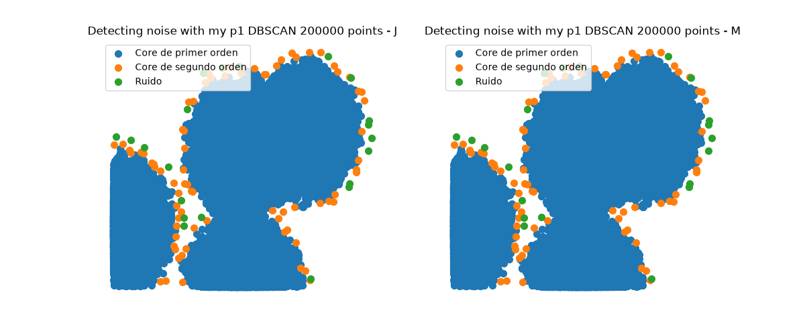
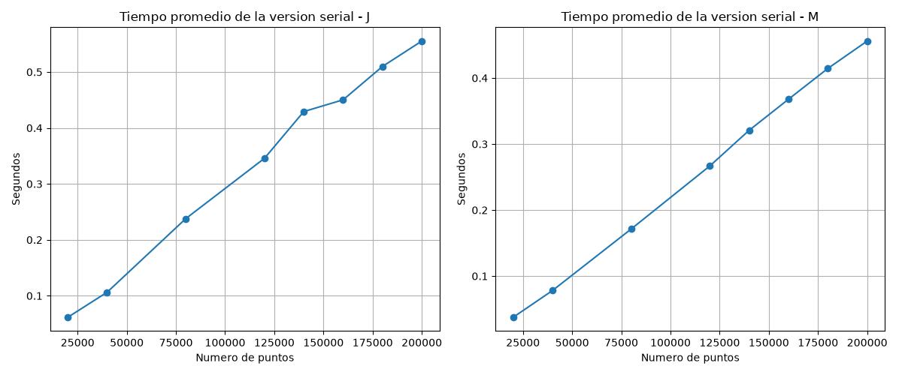
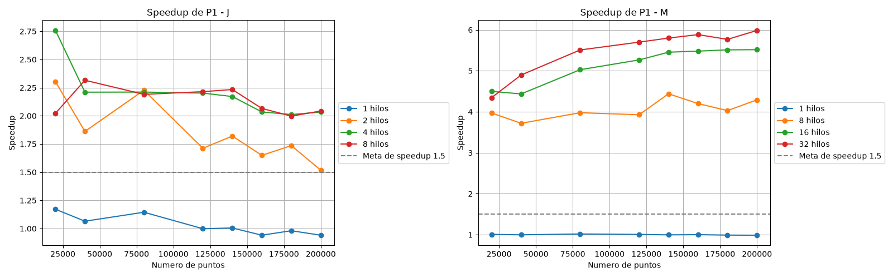
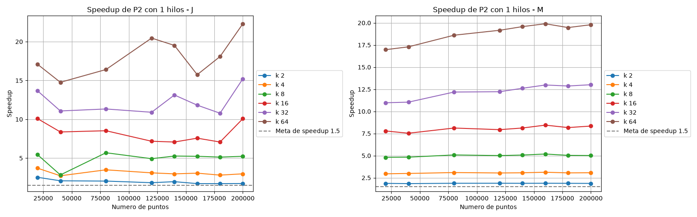
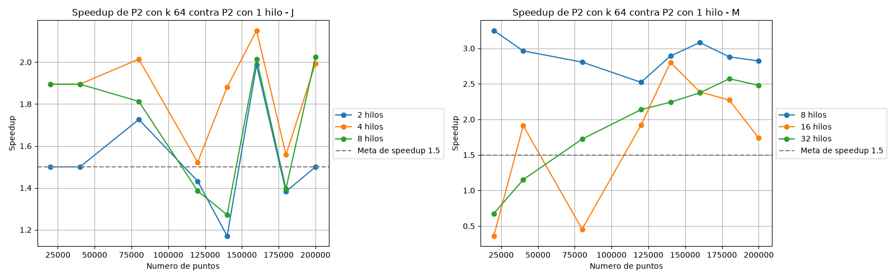
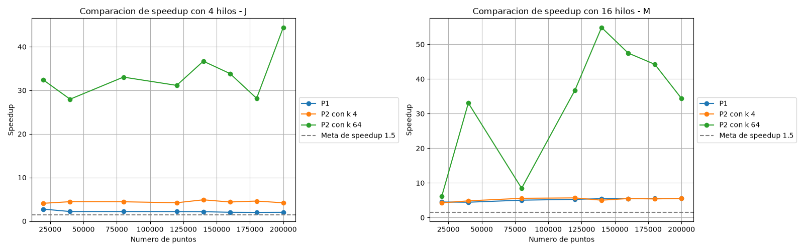

# DBSCAN
## Integrantes
* Jose Luis Santiago Heredia - 208322
* Miguel Ángel Herrera - 206111

## Objetivo
Tenemos puntos en 2D y queremos saber cuáles son ruido, es decir, son aislados, y cuáles están en una zona densa.
Para esto usamos dos cosas: un epsilon, que es la distancia máxima para considerar que dos puntos están cerca (menor o igual a 0.03), y un min_samples, que es el mínimo de puntos cerca para que se considere zona densa (10, contando el propio punto).

## Programa
### Puntos
Cada punto puede terminar con tres etiquetas:
* Core de primer orden: Tiene al menos min_samples puntos, en este caso 10, a distancia menor o igual a epsilon, contándose a sí mismo
* Core de segundo orden: No es core de primer orden, pero está a una distancia menor o igual a epsilon de algún core de primer orden
* Ruido: Ninguna de las dos

### Algoritmo
1. Cada punto cuenta cuántos puntos están a una distancia menor o igual a epsilon (contándose a sí mismo). Si llega a min_samples, se pone como core de primer orden, y si no, es ruido provisional.
2. Para los ruidos provisionales, revisa si hay algún core de primer orden a una distancia menor o igual a epsilon. Si sí hay, pasa a core de segundo orden, y si no, se queda como ruido.

El paso 2 necesita que el paso 1 ya haya terminado para todos los puntos, porque tiene que saber quiénes son core.

Este algoritmo puede tomar mucho tiempo, porque cada punto se compara contra los n puntos, entonces el costo es O(n^2) en el peor caso. Por eso, aquí veremos cómo paralelizarlo.

## Códigos
### Serial
El serial es la base contra la que se comparan las dos versiones paralelas, así que tiene que ser correcto y estar bien medido. Está en `dbscanSerial.cpp` y está dividido en funciones pequeñas:
* `contarPuntos` abre el csv y cuenta cuántos renglones tiene, para saber de qué tamaño pedir los arreglos.
* `leerPuntos` guarda la coordenada x de cada punto en un arreglo y la coordenada y en otro.
* `sonVecinos` calcula la distancia euclidiana, y regresa verdadero si es menor o igual a epsilon. 
* `dbscanSerial` tiene los dos pasos del algoritmo.
* `escribirResultados` escribe un csv con x, y y la etiqueta de cada punto (0 ruido, 1 core de primer orden, 2 core de segundo orden), que es el formato que lee la libreta para dibujar la clasificación.

En el paso 1, cada punto recorre los demás y cuenta sus vecinos, pero deja de contar en cuanto llega a min_samples, porque ya se sabe que es core y seguir contando no cambia el resultado. En el paso 2, cada ruido busca un core de primer orden cercano y deja de buscar en cuanto encuentra uno. Solo se compara contra cores de primer orden, nunca contra los de segundo orden. Así el resultado no depende del orden en que se recorren los puntos, y eso es lo que permite después paralelizar sin que cambien las etiquetas.

El main hace el experimento. Recorre los 8 tamaños, y para cada uno lee los puntos, hace una corrida de calentamiento que no se mide, porque la primera corrida siempre tardaba más, y luego corre el algoritmo 10 veces y guarda el promedio en `datos/tiempos_serial_J.csv` o `_M`, según la letra que se le pase, lo cuál es un parámetro que utilizamos para distinguir la computadora donde se corrió el experimento. El tiempo se mide con clock() justo antes y justo después de llamar a `dbscanSerial`, así que la lectura y escritura de archivos no cuentan, porque eso no se paraleliza. Como el serial corre en un solo hilo, clock() equivale al tiempo real.

Para comprobar que el serial es correcto se comparó contra el DBSCAN de sklearn con los mismos parámetros. La comparación está en la tercera celda de `DBSCAN_noise_proyecto.ipynb` y el resultado está en la sección de Resultados.

Para compilar y correr los tres programas, desde la carpeta del proyecto, después de generar los puntos con la primera celda de `DBSCAN_noise_proyecto.ipynb`:
```
g++ -O2 dbscanSerial.cpp -o dbscanSerial
g++ -O2 -fopenmp dbscanP1.cpp -o dbscanP1
g++ -O2 -fopenmp dbscanP2.cpp -o dbscanP2
.\dbscanSerial.exe J
.\dbscanP1.exe J
.\dbscanP2.exe J
```

### P1: Paralelo sobre toda la matriz
En P1 se le agrega el paralelismo al serial. Usamos OpenMP para repartir el trabajo entre varios hilos. Se pone el #pragma omp parallel for para repartir las vueltas del ciclo entre los hilos, y esto solo funciona si las vueltas son independientes. Al terminar el parallel for, el programa espera a que todos los hilos acaben antes de seguir.

Este programa es muy similar al serial, solo que le añadimos el paralelismo.

En el paso 1, cada hilo toma ciertos puntos y escribe la etiqueta de cada uno. No hay conflicto porque cada posición de la etiqueta la escribe un solo hilo.

Para el paso 2, el resultado del paso 1 se guarda en un arreglo aparte que ya no cambia, y las etiquetas finales se escriben en otro arreglo llamado etiqueta. Esto es para evitar una condición de carrera. Con esto, el paso 2 solo lee de un arreglo que no cambia y escribe en otro, así nadie lee lo que otro escribe.

Finalmente, se hace la prueba con distintas cantidades de hilos, y se comparan las etiquetas con las del serial. 

Los tiempos de P1 y P2 se miden con omp_get_wtime(), que mide tiempo de reloj de pared. No se usa clock() en las versiones paralelas porque suma el tiempo de CPU de todos los hilos, así que el tiempo paralelo saldría inflado y el speedup subestimado. El serial sí usa clock(), pero como ejecuta un solo hilo, su valor equivale al tiempo real y la comparación es válida. Con los tiempos se calcula el speedup (T_serial / T_paralelo).

### P2: Paralelo dividido en particiones
La idea de P2 es que en esta ocasión el plano se divide en k pedazos (particiones), y cada punto se compara contra los puntos de su propia partición y contra los de las particiones vecinas que estén cerca, en lugar de compararse contra todos. Sigue siendo el mismo algoritmo, solo cambia dónde busca y cómo se reparte el trabajo, y las etiquetas tienen que salir igual que en el serial.

Para hacer esto, primero se calcula la cuadrícula: se convierte k en columnas x filas, y se buscan los valores mínimos y máximos de x y de y para calcular qué tan ancha y qué tan alta es cada celda. Después a cada punto se le calcula su partición y se cuenta cuántos puntos tiene cada una, para saber en qué posición empieza. Aquí se hace una copia de los puntos ordenados por partición, y al mismo tiempo se guarda de dónde viene cada uno, para poder devolver las etiquetas en el orden original. Todo esto lo hace un solo hilo, antes del paso 1, y cuenta dentro del tiempo medido.

Un punto que está cerca de la frontera puede tener vecinos en la partición de al lado, y si no los contamos se clasificaría mal. Por eso, si un punto no junta min_samples vecinos en su propia partición, también se revisan las particiones contiguas, pero solo las que están a una distancia menor o igual a epsilon del punto. Las que están más lejos se saltan completas, porque no pueden tener vecinos suyos. De esta forma no se pierde ningún vecino y las etiquetas coinciden con las del serial.

En el paso 1, cada hilo toma una partición, y para cada uno de sus puntos cuenta cuántos vecinos hay a una distancia menor o igual a epsilon, primero en su partición y luego, si hace falta, en las vecinas cercanas. Si llega a min_samples es core de primer orden, y si no, es ruido provisional. Cada hilo solo escribe el resultado de sus propios puntos, entonces no hay conflicto. Después se espera a que todos los hilos acaben el paso 1, porque el paso 2 necesita saber quiénes son core, incluso los que son de otra partición. En el paso 2, para los ruidos provisionales se revisa si hay algún core de primer orden a una distancia menor o igual a epsilon, en su partición y en las vecinas cercanas, y si sí hay, pasa a core de segundo orden. Igual que en P1, se lee de un arreglo que ya no cambia (el resultado del paso 1) y se escribe en otro (las etiquetas finales), para que nadie lea lo que otro escribe. Al final, un último for paralelo regresa las etiquetas al orden original de los puntos.

Es importante mencionar que usamos schedule(dynamic, 1), que es cuando un hilo termina su partición y pide otra, en lugar de tener un reparto fijo. Esto es porque las particiones no tienen la misma cantidad de puntos, entonces con un reparto fijo unos hilos acabarían antes y se quedarían esperando. Con dynamic se reduce esa espera.

Otra cosa importante es que k limita el paralelismo: con k = 2 solo hay dos particiones, entonces aunque haya más hilos no tienen trabajo que tomar.

Por último, P2 puede ser más rápida incluso con un solo hilo. Probablemente porque cada punto se compara contra menos puntos (los de su partición y los de las cercanas) y porque al reordenar los puntos por partición quedan juntos en memoria. Este efecto no se debe al paralelismo, por eso hay que separar el efecto de k del efecto de los hilos.

## Resultados
### Equipos
El experimento se corrió completo en dos computadoras. Para distinguirlas, todos los archivos de `datos` y `graficas` terminan con una letra: J para la computadora de Jose Luis y M para la de Miguel. Los programas reciben esa letra al ejecutarse, por ejemplo `.\dbscanP1.exe J`.

* J: Intel Core i3 1115G4, con 2 núcleos físicos y 4 cores virtuales, Windows 10. Los hilos probados fueron 1, 2, 4 y 8.
* M: 16 cores virtuales. Los hilos probados fueron 1, 8, 16 y 32.

Los programas se compilaron con `g++ -O2`, y P1 y P2 además con `-fopenmp`. Los hilos no están fijos en el código: cada programa mide los cores virtuales con `omp_get_num_threads()` y de ahí saca 1, la mitad, todos y el doble.

### Verificación
Cada configuración compara sus etiquetas contra las del serial y avisa con un mismatch si hay diferencias. En J ninguna configuración avisó mismatch en los 8 tamaños, con todos los valores de k y de hilos. Además, los archivos de resultados son idénticos entre los tres programas y entre las dos computadoras.

En todas las gráficas, la computadora J está a la izquierda y la M a la derecha.




### Serial
El tiempo crece casi en línea recta con el número de puntos, aunque el algoritmo compara todos contra todos. Esto pasa porque casi todos los puntos son core y dejan de buscar en cuanto encuentran sus 10 vecinos. Solo los pocos puntos de ruido recorren todo el arreglo.

| Puntos | J (s) | M (s) |
|---|---|---|
| 20000 | 0.062 | 0.038 |
| 80000 | 0.238 | 0.171 |
| 120000 | 0.346 | 0.267 |
| 200000 | 0.555 | 0.456 |



Para comprobar que el serial da el resultado correcto, se comparó contra el DBSCAN de sklearn con los mismos parámetros, eps = 0.03 y min_samples = 10, usando los mismos archivos de puntos. sklearn marca el ruido con la etiqueta -1 y nuestro programa con 0, así que se comparó punto por punto si cada uno es ruido o no. Los cores de primer y de segundo orden de nuestro programa corresponden a los puntos que sklearn mete en algún cluster.

| Puntos | Ruido sklearn | Ruido serial | Diferencias |
|---|---|---|---|
| 20000 | 45 | 45 | 0 |
| 40000 | 33 | 33 | 0 |
| 80000 | 34 | 34 | 0 |

No hubo ninguna diferencia. Solo se usaron estos tres tamaños porque sklearn guarda en memoria todos los vecinos de cada punto, y con 200000 puntos eso ocuparía alrededor de 2 GB. Como P1 y P2 dan exactamente las mismas etiquetas que el serial, también coinciden con sklearn.

### P1
Speedup de P1 contra el serial con 200000 puntos:

| J | 1 hilo | 2 hilos | 4 hilos | 8 hilos |
|---|---|---|---|---|
| Speedup | 0.94 | 1.52 | 2.03 | 2.04 |

| M | 1 hilo | 8 hilos | 16 hilos | 32 hilos |
|---|---|---|---|---|
| Speedup | 0.99 | 4.29 | 5.51 | 5.98 |

Con 1 hilo P1 tarda prácticamente lo mismo que el serial, lo cual tiene sentido porque es el mismo algoritmo. Con más hilos mejora hasta que se acaban los núcleos reales. En J el tope es de cerca de 2, porque solo tiene 2 núcleos físicos. Los 4 cores virtuales son esos 2 núcleos con dos hilos cada uno, que comparten recursos, por eso de 2 a 4 hilos se gana poco y con 8 ya no se gana nada. En M el speedup sigue subiendo hasta cerca de 6.



### P2
En P2 hay que separar dos efectos, el de k y el de los hilos.

El efecto de k se ve con 1 hilo, donde no hay paralelismo. Aun así P2 es más rápido que el serial, y más entre más grande es k. Speedup de P2 con 1 hilo contra el serial con 200000 puntos:

| | k = 2 | k = 4 | k = 8 | k = 16 | k = 32 | k = 64 |
|---|---|---|---|---|---|---|
| J | 1.7 | 3.0 | 5.2 | 10.1 | 15.2 | 22.3 |
| M | 1.9 | 3.1 | 5.0 | 8.3 | 13.0 | 19.8 |
| Distancias que se ahorran | 1.9 | 3.2 | 5.5 | 9.7 | 16.6 | 29.3 |

La última fila sale de contar cuántas veces se calcula la distancia en el serial y en P2. La reducción del tiempo coincide con la reducción de distancias calculadas. En el serial los puntos se recorren en el orden del archivo, que mezcla todo el plano, y un punto core revisa en promedio unos 1470 puntos antes de juntar sus 10 vecinos. En P2 primero busca en su partición, donde todos los puntos están cerca, y encuentra sus vecinos mucho antes. El tiempo baja un poco menos que las distancias porque acomodar los puntos por partición también cuesta.

El efecto de los hilos se ve comparando P2 contra P2 con 1 hilo y el mismo k. Con 200000 puntos y k = 64, los hilos dan 2.02 en J con 8 hilos y 2.82 en M con 8 hilos. Es menos que en P1 por tres razones:
* Con k particiones solo puede haber k hilos trabajando, así que con k = 2 el máximo es 2.
* Las particiones tienen cantidades de puntos muy distintas, porque los puntos vienen de 4 nubes. Con k = 4 la partición más grande tiene el 39% de los puntos, y con k = 64 tiene el 11% y hay 9 particiones vacías. Los hilos que terminan antes tienen que esperar a la partición más grande.
* La preparación de las particiones la hace un solo hilo y entra en el tiempo medido. Con k = 64 todo P2 tarda pocos milisegundos, así que esa parte pesa.

El mejor speedup de P2 contra el serial fue de 45 en J, con 200000 puntos, k = 64 y 8 hilos, y de 61 en M, con 160000 puntos, k = 64 y 8 hilos.

En M los resultados con 16 hilos son irregulares, por ejemplo con 80000 puntos y k = 64 el speedup baja a 8.5 cuando con 8 hilos es 52. Esas corridas duran milisegundos y con 16 hilos se ocupan todos los cores virtuales, así que cualquier otro proceso de la computadora retrasa a algún hilo y los demás tienen que esperarlo.





### Comparación entre P1 y P2
Las dos versiones pasan la meta de speedup de 1.5 en las dos computadoras. P2 fue mucho más rápida en tiempo total, pero sobre todo porque al dividir el plano en particiones calcula muchas menos distancias, no por los hilos. P1 fue la que mejor aprovechó los hilos, porque reparte puntos y no zonas, entonces a cada hilo le toca un trabajo parecido. En P2 el reparto depende de cuántos puntos caen en cada partición, y con estos datos queda muy disparejo.



### Comparación entre las dos computadoras
Con un solo hilo las dos computadoras son parecidas. El serial fue entre 1.2 y 1.6 veces más rápido en M, y P2 con 1 hilo y k = 64 entre 1.1 y 1.6 veces. La diferencia grande aparece al usar varios hilos.

Lo más interesante es la corrida con 8 hilos, porque las dos computadoras la hicieron. En J, 8 hilos es el doble de sus cores virtuales, y en M es la mitad. Con 200000 puntos:

| | J con 8 hilos | M con 8 hilos | M más rápido |
|---|---|---|---|
| P1 | 0.272 s, speedup 2.04 | 0.106 s, speedup 4.29 | 2.6 veces |
| P2 con k = 4 | 0.125 s, speedup 4.5 | 0.071 s, speedup 6.4 | 1.7 veces |
| P2 con k = 64 | 0.012 s, speedup 45.1 | 0.008 s, speedup 55.8 | 1.5 veces |

Con el mismo número de hilos, M es 2.6 veces más rápida en P1 y solo 1.5 veces en P2 con k = 64. La razón es que en J los 8 hilos se reparten entre 2 núcleos físicos, así que la mayoría están esperando su turno, mientras que en M cada hilo tiene un core virtual para él solo. Pedir más hilos no da más velocidad si el hardware no los tiene. P1 es la que más lo resiente porque es la que mejor reparte el trabajo, entonces es la que más aprovecha tener núcleos de verdad. En P2 la diferencia es menor porque, como se vio, P2 casi no pasa de 2 a 3 veces con los hilos aunque haya núcleos libres, así que tener más núcleos le sirve menos.

## Conclusión
Hicimos tres versiones del algoritmo ingenuo de DBSCAN para detectar ruido: una serial, P1, que reparte los puntos entre los hilos sin dividir la matriz, y P2, que divide el plano en k particiones y reparte particiones. Las tres dan exactamente las mismas etiquetas en todos los tamaños y configuraciones. Ninguna versión paralela tiene condiciones de carrera, porque cada hilo solo escribe la etiqueta de sus propios puntos y el paso 2 lee el resultado del paso 1 de un arreglo que ya no cambia. Para mantener la consistencia en P2, cada punto revisa también las particiones vecinas que están a distancia epsilon o menos, así que no se pierde ningún vecino del otro lado de una frontera.

Las dos versiones paralelas superan la meta de speedup de 1.5 en las dos computadoras. P1 llegó a 2.8 en J y a 6 en M, y P2 llegó a 45 en J y a 61 en M.

P2 fue la más rápida, pero hay que leer bien por qué. La mayor parte de su ventaja viene de dividir el plano: aun con 1 hilo, con k = 64 calcula cerca de 29 veces menos distancias que el serial, porque cada punto busca primero entre los puntos que tiene cerca. Los hilos le aportan solo entre 2 y 3 veces más, porque las particiones quedan con cantidades de puntos muy distintas y k limita cuántos hilos pueden trabajar a la vez. P1, en cambio, fue la que mejor aprovechó los hilos, porque a cada hilo le toca un trabajo parecido.

También vimos que el hardware pone el límite. Con 1 hilo las dos computadoras son parecidas, pero con 8 hilos M fue 2.6 veces más rápida en P1, porque tiene núcleos suficientes para esos hilos y J solo tiene 2 núcleos físicos. Usar más hilos que cores no mejoró en ninguna de las dos.

Por último, con tiempos de pocos milisegundos las mediciones se vuelven ruidosas, por ejemplo los resultados de P2 con 16 hilos en M. Por eso promediar 10 repeticiones, hacer una corrida de calentamiento y correr sin otros programas abiertos fue importante para que los resultados fueran confiables.

## Uso responsable y ético de IA Generativa
Siguiendo los lineamientos de IEEE y de Elsevier que vienen en las instrucciones, declaramos que en este proyecto usamos IA generativa, en particular Claude de Anthropic.

La usamos como apoyo para:
* Proponer la estructura de los programas y revisar errores en el código.
* Hacer las visualizaciones de la libreta: las gráficas de clasificación, de tiempo y de speedup.
* Mejorar la redacción y ordenar partes de este documento.

Para usarla de forma responsable:
* Revisamos y entendimos todo el código entregado, y somos responsables de él y de lo que dice este documento. 
* La IA no es autora del trabajo, es una herramienta. Las decisiones sobre cómo paralelizar, qué experimentos correr y cómo interpretar los resultados fueron nuestras.